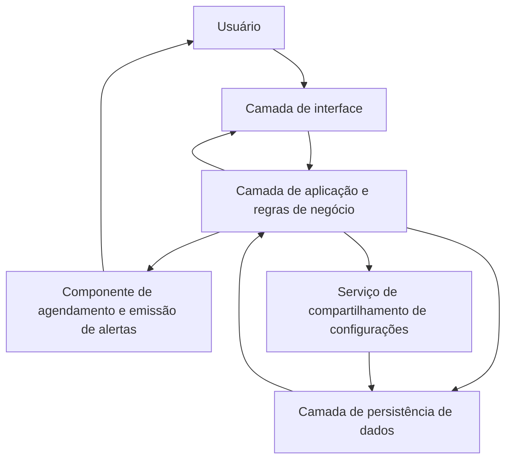

# Arquitetura — Agenda de Tarefas

## 1. Objetivo

Este documento descreve uma arquitetura lógica para a Agenda de Tarefas com base na visão do projeto, nos requisitos e nos casos de uso disponíveis. Os documentos de origem definem funcionalidades e necessidades, mas **não especificam linguagem de programação, framework, banco de dados, plataforma de execução ou forma de implantação**. Por isso, esta arquitetura apresenta responsabilidades e relações conceituais, sem afirmar que uma tecnologia específica já foi escolhida.

## 2. Visão geral

A aplicação pode ser organizada em camadas lógicas para separar a interação com o usuário, as regras das funcionalidades e o armazenamento persistente dos dados.

O diagrama é conceitual. Ele não representa tecnologias, processos físicos ou uma implantação já definida. O componente de alertas e o serviço de compartilhamento aparecem separados para tornar suas responsabilidades explícitas; ambos podem fazer parte da mesma aplicação, dependendo da implementação.

## 3. Camadas e responsabilidades

### 3.1 Camada de interface

Responsável por apresentar as telas e receber as ações do usuário.

Responsabilidades principais:
- Apresentar cadastro e login;
- Exibir o calendário com tarefas, lembretes e alertas;
- Oferecer formulários de criação, edição e personalização dos registros;
- Apresentar configurações específicas predefinidas;
- Permitir consultar, compartilhar e utilizar configurações compartilhadas;
- Organizar as funcionalidades em um menu lateral;
- Exibir mensagens de validação, sucesso e erro;
- Apresentar os alertas ao usuário por meio dos recursos suportados pela plataforma escolhida.

A interface deve atender às necessidades de simplicidade, facilidade de uso e personalização descritas nos requisitos não funcionais.

### 3.2 Camada de aplicação e regras de negócio

Responsável por executar as operações solicitadas pela interface e aplicar as regras da agenda.

Responsabilidades principais:
- Validar os dados de cadastro e impedir o cadastro de e-mail já utilizado;
- Verificar as credenciais durante o login;
- Controlar o acesso às funcionalidades que exigem autenticação;
- Criar, consultar, personalizar e atualizar registros;
- Associar cada registro à conta responsável;
- Disponibilizar as configurações predefinidas do sistema;
- Coordenar o compartilhamento e a utilização de configurações de outros usuários;
- Manter os dados atualizados para a apresentação no calendário;
- Encaminhar as informações necessárias ao componente de alertas.

As operações de leitura e alteração de registros devem considerar a conta autenticada, de modo que um usuário não possa alterar registros pertencentes a outro apenas por meio da interface. Esse é um cuidado arquitetural derivado do modelo de contas e registros individuais descrito nos casos de uso.

### 3.3 Camada de persistência de dados

Responsável por armazenar e recuperar os dados necessários ao funcionamento da aplicação, inclusive depois do fim da sessão, conforme RNF-05.

Dados que precisam ser persistidos de acordo com os documentos:
- Dados da conta: nome, e-mail e senha, com armazenamento seguro da credencial;
- Registros de tarefas, alertas e lembretes;
- Informações de personalização dos registros, como nome, descrição, cor, formato, data e horário;
- Configuração de som prevista para os alertas;
- Relação entre os registros e o usuário responsável;
- Informações necessárias para indicar quais configurações foram compartilhadas e quais estão disponíveis para reutilização;
- Configurações predefinidas oferecidas pelo sistema.

Os documentos não indicam qual banco de dados será usado nem o esquema físico das tabelas ou coleções. A tecnologia e o modelo de armazenamento deverão ser definidos na etapa de projeto técnico.

### 3.4 Componente de agendamento e emissão de alertas

Responsável por acompanhar os registros configurados para gerar alertas e acionar a notificação quando a data e o horário forem alcançados.

Fluxo lógico:
1. Obter os registros que possuem alerta configurado.
2. Verificar a data e o horário definidos.
3. Identificar os alertas cujo momento de execução foi alcançado.
4. Utilizar as configurações associadas ao registro, incluindo o som quando aplicável.
5. Solicitar a apresentação do alerta no dispositivo do usuário.

Os documentos não especificam como a verificação será executada em segundo plano nem qual mecanismo de notificação estará disponível. A solução técnica deverá considerar a plataforma de destino e suas restrições. Portanto, não se presume que alertas funcionarão com o aplicativo fechado até que esse comportamento seja definido e validado na implementação.

### 3.5 Serviço de compartilhamento de configurações

Responsável por disponibilizar registros personalizados para outros usuários e permitir que esses usuários reutilizem uma configuração compartilhada.

Responsabilidades principais:
- Identificar o registro que o usuário deseja compartilhar;
- Registrar que a configuração está disponível para outros usuários;
- Apresentar as configurações compartilhadas disponíveis;
- Permitir que um usuário selecione uma configuração compartilhada;
- Criar na agenda do usuário uma instância baseada na configuração escolhida.

O caso de uso descreve a utilização da configuração compartilhada como um registro adicionado à agenda do usuário. A implementação deve evitar que a edição posterior do registro de origem altere silenciosamente o registro já criado na agenda de outra pessoa, salvo se o projeto definir explicitamente esse comportamento.

## 4. Principais entidades conceituais

As entidades abaixo são uma proposta de organização conceitual inferida dos requisitos e casos de uso. Ainda não representam um modelo de banco de dados validado.

| Entidade | Finalidade | Informações principais previstas |
| --- | --- | --- |
| Usuário | Representar a conta de uma pessoa na plataforma. | Identificador, nome, e-mail e credencial protegida. |
| Registro | Representar uma tarefa, lembrete ou alerta da agenda. | Identificador, tipo, nome, descrição, cor, formato, data, horário, configuração de som quando aplicável e usuário responsável. |
| Configuração predefinida | Representar um modelo disponibilizado pelo sistema. | Tipo ou finalidade e valores padrão necessários para criar o registro. Exemplos: ingestão de água e exercício físico. |
| Compartilhamento | Representar a disponibilização de uma configuração por um usuário para reutilização. | Referência à configuração compartilhada e ao usuário que a disponibilizou, conforme o modelo de acesso que vier a ser definido. |

A estrutura final pode consolidar ou dividir essas entidades. Por exemplo, uma configuração compartilhada pode ser modelada como um estado do registro, uma entidade própria ou uma cópia publicada. Os documentos atuais não determinam qual alternativa deve ser utilizada.

## 5. Fluxos arquiteturais principais

### 5.1 Cadastro e login

1. A interface recebe nome, e-mail e senha no cadastro, ou e-mail e senha no login.
2. A camada de aplicação valida os dados e executa as regras correspondentes.
3. A camada de persistência grava a conta ou recupera os dados necessários para verificar a autenticação.
4. A aplicação retorna uma confirmação ou uma mensagem de erro à interface.
5. Depois da autenticação, o usuário pode acessar as funcionalidades protegidas da agenda.

### 5.2 Criação, visualização e edição de registros

1. O usuário inicia a criação ou seleciona um registro existente na interface.
2. A aplicação valida os dados enviados e associa a operação ao usuário autenticado.
3. A persistência armazena o novo registro ou atualiza o existente.
4. A aplicação retorna o resultado e os dados atualizados.
5. A interface atualiza a apresentação do calendário.

### 5.3 Compartilhamento e reutilização

1. O usuário seleciona uma configuração personalizada e solicita seu compartilhamento.
2. A aplicação registra a disponibilidade da configuração.
3. Outro usuário autenticado consulta a área de registros compartilhados e escolhe uma configuração.
4. A aplicação cria um registro associado à agenda do usuário que fez a seleção.
5. A interface apresenta a confirmação e o novo registro.

### 5.4 Emissão de alerta

1. O registro é salvo com data, horário e opções de alerta.
2. O componente de agendamento consulta ou recebe os registros que precisam ser monitorados.
3. Ao alcançar o momento configurado, o componente solicita a exibição do alerta no dispositivo.
4. A notificação utiliza as opções compatíveis com a plataforma e com a configuração do registro.

## 6. Requisitos não funcionais e decisões arquiteturais

| Requisito | Consequência para a arquitetura |
| --- | --- |
| RNF-01 — Interface eficiente | Separar a apresentação das regras de negócio e manter os fluxos de uso objetivos. |
| RNF-02 — Usabilidade | Retornar mensagens claras e validar entradas de modo compreensível. |
| RNF-03 — Organização em menu | Manter navegação consistente entre as principais áreas da interface. |
| RNF-04 — Interface personalizável | Prever um ponto de configuração para as opções de interface que forem definidas pelo projeto. |
| RNF-05 — Persistência de informações | Armazenar os dados de forma persistente, para que permaneçam disponíveis após o fim da sessão. |

Além desses requisitos, o modelo de contas torna importante proteger as credenciais e restringir a leitura e alteração de dados ao usuário autorizado. A tecnologia concreta para aplicar esses cuidados ainda não está definida nos documentos.

## 7. Decisões pendentes

Antes de transformar esta arquitetura lógica em arquitetura técnica, é necessário definir:

- Plataforma-alvo: web, aplicativo móvel, desktop ou outra combinação;
- Linguagem, framework e organização do projeto;
- Banco de dados e modelo de persistência;
- Forma de autenticação e proteção das credenciais;
- Mecanismo de agendamento e entrega de notificações;
- Comportamento dos alertas com o aplicativo em segundo plano ou fechado;
- Regras exatas de visibilidade, cópia, atualização e eventual retirada de configurações compartilhadas;
- Quais elementos da interface poderão ser personalizados.

Esses pontos estão em aberto porque não são definidos na visão do projeto, na lista de requisitos ou nos casos de uso fornecidos.

## 8. Rastreabilidade com os casos de uso

| Casos de uso | Componentes envolvidos principalmente |
| --- | --- |
| UC-01 — Cadastrar usuário | Interface, aplicação e persistência |
| UC-02 — Realizar login | Interface, aplicação, persistência e controle de acesso |
| UC-03 — Visualizar calendário | Interface, aplicação e persistência |
| UC-04 — Criar registro | Interface, aplicação e persistência |
| UC-05 — Personalizar registro | Interface, aplicação e persistência |
| UC-06 — Editar registro | Interface, aplicação e persistência |
| UC-07 — Compartilhar registro | Interface, serviço de compartilhamento e persistência |
| UC-08 — Utilizar registro compartilhado | Interface, serviço de compartilhamento, aplicação e persistência |
| UC-09 — Receber alerta | Aplicação, persistência e componente de agendamento/alertas |
| UC-10 — Utilizar configuração específica | Interface, aplicação, configurações predefinidas e persistência |
| UC-11 — Navegar pelo menu | Interface |
